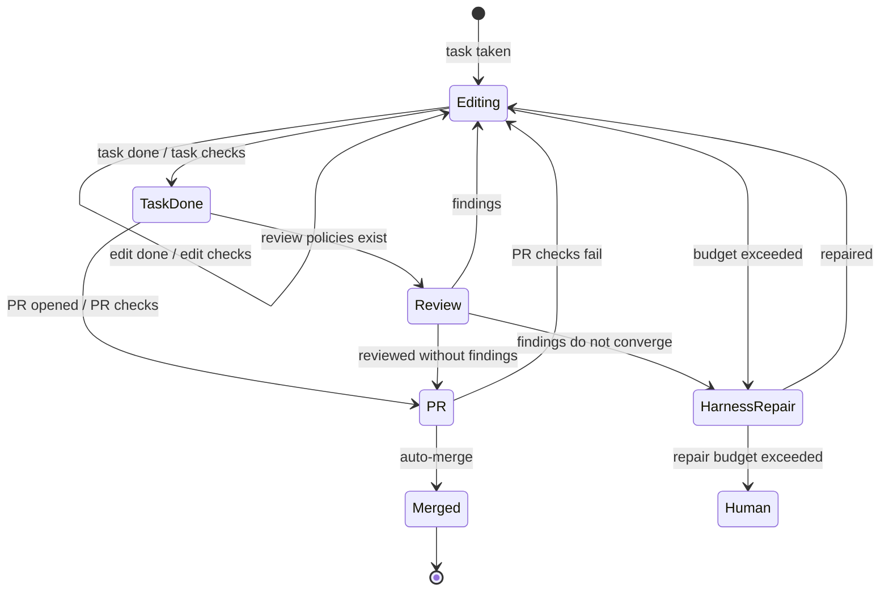

# shampoo

> Lather, rinse, repeat.

A software factory that keeps coding agents building a project with humans out of the loop (HOOTL).

## How It Works



- **Gates on every step**: The agent's hooks load `.shampoo/policies/` at session start and run `shampoo guard` on every edit and stop. Review findings and CI failures send the agent back to `Editing`.
- **Automatic progression and merge**: `shampoo next` inspects git, GitHub, and a local ledger under `.git` to decide which step a task is in — and merges the PR via `gh` once the GitHub Actions workflows matching the changed files pass.
- **Bounded retries**: Violations, slow checks, and open questions are counted against budgets. Instead of retrying forever, repeated failures move work to `HarnessRepair`, reaching `Human` only when repairs run out.

## Prerequisites

- `git` (repository on GitHub with GitHub Actions)
- GitHub CLI (`gh`), authenticated (`gh auth login`) — views/merges PRs, reads workflow runs, and opens/checks issues
- Go 1.27+

## Installation

```bash
go install github.com/toms74209200/shampoo@latest
```

Make sure `shampoo` is in your `PATH`, then install the skills (`~/.claude/skills/` or your agent's skills directory):

```bash
curl -fsSL --create-dirs -o ~/.claude/skills/shampoo-init/SKILL.md https://raw.githubusercontent.com/toms74209200/shampoo/master/.claude/skills/shampoo-init/SKILL.md
```

```bash
curl -fsSL --create-dirs -o ~/.claude/skills/shampoo-start/SKILL.md https://raw.githubusercontent.com/toms74209200/shampoo/master/.claude/skills/shampoo-start/SKILL.md
```

## Usage

### 1. Initialize the repository

Run `/shampoo-init` once in the target repository.

The agent inspects existing lint, test, coverage, and CI settings, asks only what remains open, writes `.shampoo/` and `tasks/`, wires the agent's hooks to shampoo (without overwriting existing files), and opens a setup PR. Merge that PR first.

### 2. Prepare tasks

Add tasks to your task source (by default, one Markdown file per task under `tasks/` with its completion criteria).

### 3. Run the loop

Run `/shampoo-start`.

From here the loop runs hands-off: taking a task on a new branch, checking edits and stops through hooks, reviewing against policies, opening a PR, fixing failed CI runs, **auto-merging the PR via `gh`** once expected workflows pass, and moving on to the next task until none remain.

### 4. Step in only when asked

- **Question issue opened**: When an agent cannot settle a trade-off, it decides, keeps working, and opens a GitHub issue (`shampoo ask`). Reply and close the issue whenever convenient.
- **Loop paused (`wait-for-human` / `hand-to-human`)**: Too many question issues are open, workflow reviews kept failing, or a branch ran out of repair attempts. Close the waiting issues or finish the handed-off branch, then run `/shampoo-start` again.

## Commands

Called under the hood by skills and hooks:

| Command | What happens |
|---|---|
| `shampoo init` | Writes `.shampoo/` from JSON on `stdin` (keeps existing files); nothing of any agent's |
| `shampoo next` | Prints the next action as JSON; merges passing PRs via `gh`, or opens an issue if workflow reviews keep failing |
| `shampoo guard <edit\|task>` | Runs checks for changed files and records outcomes in `.git` (`0` pass, `1` task failure, `2` workflow failure, `3` repair harness, `4` hand to human) |
| `shampoo policies` | Prints `.shampoo/policies/` and `shampoo ask` instructions to `stdout` |
| `shampoo review` | Records policy review findings in `.git` from JSON on `stdin` |
| `shampoo ask` | Opens a GitHub issue via `gh` from JSON on `stdin` and records it in `.git` |

## Documentation

- [Design Document](docs/design.md)
- [Development Guide](docs/development.md)

## License

[MIT License](LICENSE)

## Author

[toms74209200](https://github.com/toms74209200)
