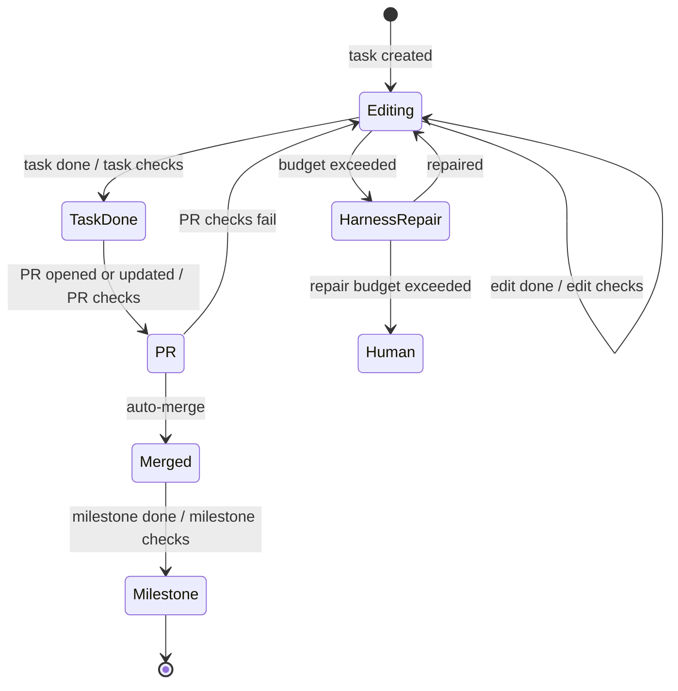

# shampoo: A Software Factory — Design Doc

> Lather, rinse, repeat.

- Status: Draft
- Created: 2026-11-17
- Name: `shampoo`

shampoo is a software factory: it keeps agents building a project with humans out of the loop (HOOTL). It is not tied to a particular project; a project plugs in its own checks and task sources. jeer is its first project.

| Part | Question |
|---|---|
| I. Why | Why build this? |
| II. What | What does the factory do, and what must it satisfy? |
| III. Usage | How does a project use it? |
| IV. Solution Design | How is it built? |

---

# Part I. Why

## 1. Motivation
When implementation becomes cheap, verification becomes most of the work (one practitioner reports about 70% of daily tokens going to verification [1]). Agents can write code fast; what limits them is whether their output can be trusted, and that depends on deterministic checks running at the right moments.

Today a human sits in that loop: assigning tasks, judging whether work is done, merging, and repairing the harness when it breaks. shampoo takes the human out of the loop. Humans set direction and review asynchronously; the loop keeps running without waiting for them.

---

# Part II. What

## 2. The SDLC as a state machine
The whole development lifecycle is a state machine. Work moves between states through transitions, and checks are the guards on those transitions. A check runs when, and only when, the transition it guards is attempted. There are no calendar-based runs.



Triggers do not add a schedule: an observed trigger creates a task, which enters the machine at Editing like any other.

## 3. Budgets
Transitions are governed by budgets, in the manner of SRE error budgets. When to retry, escape, stop product work, or fix a check is decided by which budget is exceeded, not by ad hoc rules.

| Budget | Charged by | When exceeded |
|---|---|---|
| Retry | Each failed attempt at a transition | Escape to harness repair |
| Workflow failure | Failures caused by the harness rather than the work: tool crashes, oracle nondeterminism, flaky tests | Stop product work; repair the harness |
| Time | A check's run time, against its test size's time limit [2] | Reorganize the check |
| False positive | Exceptions to a check | Fix the check |
| Human review | Exceptions and workflow changes awaiting asynchronous human review | Stop until reviewed |

Charging the right budget requires telling a task failure (the check found a problem in the work) from a workflow failure (the harness misbehaved). Every check reports which one it is.

Initial values are guesses and are adjusted from observation.

## 4. Requirements for HOOTL
The loop must keep running with no human present. That requires:

| Requirement | Why |
|---|---|
| Task supply | The next piece of work must appear without a human assigning it |
| Agent launch | Each task gets its own worktree and a headless agent session |
| Auto-merge | Work that passes the PR checks merges without waiting for a human |
| Failure classification and the workflow-failure budget | A broken harness must not be retried forever as if it were a task failure |
| Self-healing | Escapes become harness-repair tasks for an agent. A human is reached only when the repair budget is exhausted |
| Asynchronous human review | Human approval never blocks the loop directly; only the human-review budget does |

## 5. Principles for checks
- **A check failure always sends the work back.** No warnings
- **False positives pass only through an explicit exception with a written reason**, counted against that check's budget
- **Exceeding the budget means fixing the check**, not adding exceptions
- **Checks follow test sizes [2].** A check's size decides the earliest transition it can guard: small from edit done, medium from task done, large from PR
- **Checks are added when a trigger is observed**, cheapest first, and reorganized on cost (run time, failure cost). A check is not removed for catching nothing: catching nothing does not show it is ineffective
- **Agents don't change the checks that judge their own work.** Such changes go through the human-review budget

### 5.1 Acceptance tests
Tests come in two kinds, and only one of them belongs to the implementation:

| Kind | Role | In the same task as the implementation |
|---|---|---|
| White-box (small) tests | The implementer's own design artifacts; they depend on internal structure | Yes |
| Feature specs and black-box (acceptance) tests | The spec, made executable: checks that judge the implementation | No |

- **An implementation task never changes acceptance tests.** This follows from the rule above: an implementation that may rewrite its acceptance tests can pass anything
- **A behavior change starts with a spec-change task.** It updates the feature specs and acceptance tests, and goes through the human-review budget. Implementation tasks follow it
- **Acceptance tests ratchet.** A test is identified by its name and a hash of its definition. At the PR guard, every test that passes on the merge-base must still pass on the head, unless its definition changed; the base is git, not the ledger, so local runs and CI judge the same way. A test whose definition changed counts as new: it is not yet required to pass, so a spec change can land before its implementation. The milestone guard requires all acceptance tests to pass
- **A previously passing test that fails with an unchanged definition is a regression**: a task failure, sent back
- **When a spec change missed something** (e.g. a format change also breaks another command's tests), the implementation cannot satisfy both, exhausts its retry budget, and escapes. The repair is another spec-change task. An implementation agent that finds the spec wrong does not edit it; it escapes and proposes the spec change

### 5.2 Rules and policies
| Term | Definition |
|---|---|
| Rule | A categorical constraint on the work: it must hold. Its violation fails the transition and sends the work back |
| Check | The implementation of rules: a deterministic executable that judges the work at a transition, reporting pass, task failure or workflow failure (§3, §7) |
| Policy | Guidance that the harness puts into the agent's context. No check detects its violations; it takes effect only as far as the agent follows it |

- **The harness puts policies into the context at fixed times**: all policies when the orchestrator starts a task, and all of them again after the context is compacted. The agent does not choose whether to load them
- **A policy may carry a code example**: written inline, a reference `path#L<start>-L<end>` at a fixed commit, or none
- **Every rule passes on every code example.** A rule that fails on one contradicts the policy, and the rule is fixed
- **Policies and rules are defined independently**, in the project's configuration (§7). shampoo provides no defaults: their content is the project's own

## 6. Non-goals
- Project-specific checks: these come from the project (§7)
- Replacing CI or the code host: shampoo drives GitHub and GitHub Actions rather than reimplementing them

---

# Part III. Usage

## 7. What a project provides
- **Checks per transition**, each with a test size
- **Exit-code mapping**: how each check's exit codes map to pass / task failure / workflow failure
- **Policies**, each with its code example (§5.2)
- **Task sources**: where tasks come from (for jeer: clusters of mismatches against the oracle)

## 8. Commands
- `shampoo run`: the orchestrator. A long-running server that watches state and drives transitions between sessions (§11)
- `shampoo guard <transition>`: runs the guard for a transition. Called by hooks and CI

---

# Part IV. Solution Design

Implementation language: Go. The core is concurrent coordination (the reconciliation loop, agent sessions, CI results), and a Go binary starts fast enough for hooks to call `shampoo guard` directly.

## 9. Components

```
          task sources (project)
                 │
                 ▼
 ┌──────────────────────────────┐
 │ orchestrator (shampoo run)   │── worktree + headless agent session per task
 └──────────────────────────────┘
                 │ hooks / CI
                 ▼
 ┌──────────────────────────────┐      ┌────────────┐
 │ guard (shampoo guard)        │─────▶│ ledger     │
 │ checks → classify → decide   │      │ (SQLite)   │
 └──────────────────────────────┘      └────────────┘
                 │                            │
                 ▼                            ▼
   pass / send back / escape         budgets → self-healing tasks
```

## 10. Transitions

| Transition | Mechanism |
|---|---|
| Edit done | Claude Code PostToolUse hook on every tool [3]. It ignores which tool ran (agents also edit through Bash, Python, sed) and looks at files: what changed since the last passed guard, recorded as a git tree at each pass. If nothing changed, it does nothing |
| Task done | Claude Code Stop hook [3] in a headless session launched by the orchestrator. With no human to ask, every stop is an attempt at task done: the agent either thinks it is done or is stuck, and in both cases the guard decides |
| PR | CI on GitHub Actions, running `shampoo guard pr` |
| Merge | The orchestrator merges once the checks the change calls for have passed (below) |
| Milestone | A GitHub milestone, plus a manually dispatched workflow for large checks |
| Escape | The guard stops blocking and records the escape; the orchestrator creates a harness-repair task |

Which checks a PR needs depends on what it changes, since each workflow starts from the paths it checks. GitHub's required checks are a fixed list, and a required check whose workflow did not start waits forever; its auto-merge waits only on that list. So the merge is decided by the orchestrator:
- **Expected checks** are derived from the PR's changed paths, by the same rules as the workflows' path filters. The commit message check is always expected
- **The results that count** are those of runs started by the PR's latest commit that no run pushed. A run may change the code before checking it and push what it produced; those commits, on top of it, are the run's output and are covered by its results
- **A missing expected check means wait**, whatever the cause: a run not yet registered, one awaiting approval, or a commit that started none. Waiting past a time limit is a workflow failure
- **Automation delivers changes as PRs** opened with a token that starts workflows, never by pushing to another PR's branch, and no commit may skip CI

## 11. Who drives transitions
Transitions are driven by three actors.

| Actor | Transitions | How |
|---|---|---|
| Hooks (inside a session) | Edit done, task done | Synchronous calls to the guard. They must be synchronous, since the result decides whether the agent is sent back |
| Orchestrator (`shampoo run`) | Task done → PR, PR failed → Editing, PR passed → Merged, escape → harness repair | A reconciliation loop: it observes the actual state (git, GitHub, ledger) and acts to close the gap to the desired state |
| GitHub | PR checks | CI |

The orchestrator is level-triggered rather than event-driven. It does not react to events that could be lost; it looks at the state each time and decides the next action from it (e.g. a worktree with no running session and a passed task guard → open a PR; a PR with failing checks and no running session → launch a session to fix it). A restart only needs to look at the state again. Observing state periodically is not a scheduled check: checks still run only when a transition is attempted. Event notifications (e.g. webhooks) can be added later to wake the loop if its latency becomes a problem.

The flow of one task:
1. The orchestrator takes a task, creates a worktree, and launches a headless session
2. On every tool call, the PostToolUse hook calls `shampoo guard edit`; on failure the agent gets the reason and fixes it
3. When the agent tries to stop, the Stop hook calls `shampoo guard task`. On failure with retry budget left, the agent is sent back with the reason. On pass, or when the budget is exhausted, the stop is allowed and the outcome is recorded in the ledger
4. The orchestrator sees the ended session and the recorded outcome: on pass it pushes the branch and opens a PR with auto-merge; on escape it creates a harness-repair task
5. CI runs `shampoo guard pr`. On pass, the orchestrator merges. On failure, the orchestrator launches a new session in the same worktree with the failure reason

## 12. State and ledger
- **State** is derived from git and GitHub (a branch per task in its own worktree, the PR, whether it is merged). There is no separate state file to drift
- **Ledger**: SQLite (WAL mode) in the git common directory, shared by all worktrees and not tracked. Each transition attempt is recorded: task, transition, check, outcome, duration. Retry, workflow-failure, and time budgets are counted from it, and it is kept as the evidence for tuning budgets
- **Not in the ledger**: false-positive exceptions are counted from the code itself; the freeze flag is a labeled issue on GitHub, so CI can enforce it too; PR failures come from GitHub's check history

## 13. Bootstrapping
shampoo cannot be built by shampoo before it exists. It is built with a human in the loop up to the point where it can run HOOTL, and from then on its own changes go through shampoo.

The risk: whatever the guards miss at that point is carried into everything shampoo builds afterwards, including itself.

---

## 14. References
- [1] Lauren Tan, "All Code Is Slop (Except Mine)", AI Engineer CODE 2026. https://ai.engineer/code/2026/talks/lauren-tan
- [2] Google Testing Blog, "Test Sizes", 2010. https://testing.googleblog.com/2010/12/test-sizes.html
- [3] Claude Code hooks reference. https://code.claude.com/docs/en/hooks
