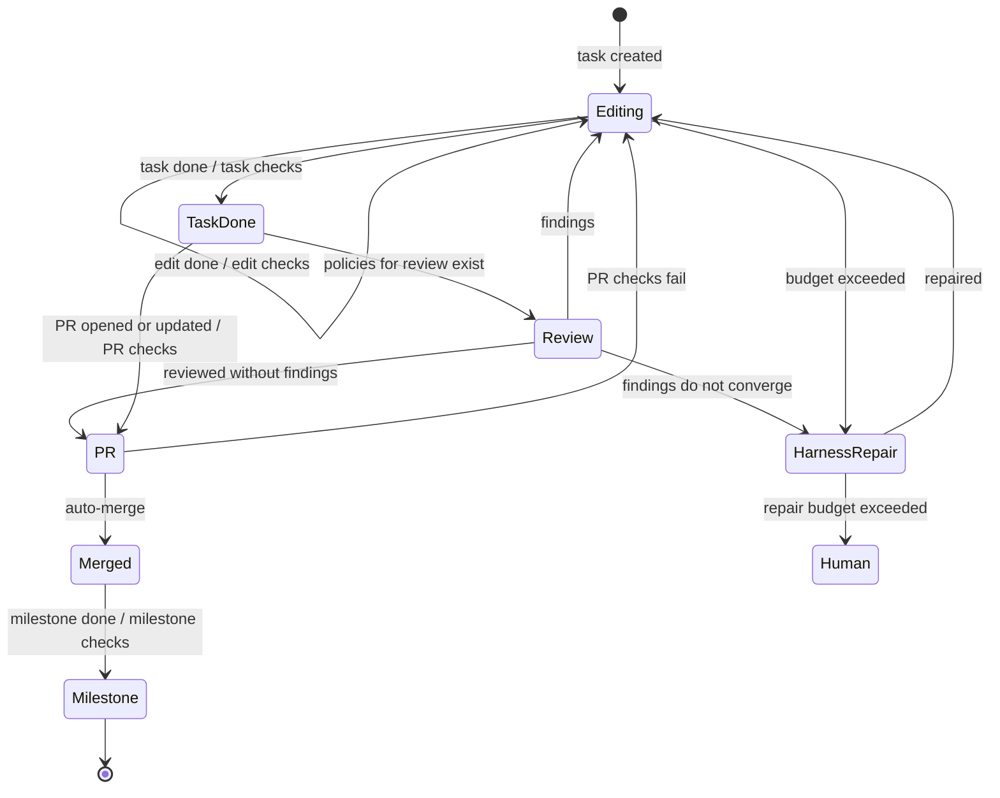

# shampoo: A Software Factory — Design Doc

> Lather, rinse, repeat.

- Status: Draft
- Created: 2026-11-17
- Name: `shampoo`

shampoo is a software factory: it keeps agents building a project with humans out of the loop (HOOTL). It is not tied to a particular project; a project plugs in its own checks and task sources. jeer is its first project.

| Part | Question |
|---|---|
| I. Why | Why build this? |
| II. What | What does the factory do, and what must it satisfy? |
| III. Usage | How does a project use it? |
| IV. Solution Design | How is it built? |

---

# Part I. Why

## 1. Motivation
When implementation becomes cheap, verification becomes most of the work (one practitioner reports about 70% of daily tokens going to verification [1]). Agents can write code fast; what limits them is whether their output can be trusted, and that depends on deterministic checks running at the right moments.

Today a human sits in that loop: assigning tasks, judging whether work is done, merging, and repairing the harness when it breaks. shampoo takes the human out of the loop. Humans set direction and review asynchronously; the loop keeps running without waiting for them.

---

# Part II. What

## 2. The SDLC as a state machine
The whole development lifecycle is a state machine. Work moves between states through transitions, and checks are the guards on those transitions. A check runs when, and only when, the transition it guards is attempted. There are no calendar-based runs.



Review is a phase, not a check: it exists only when a policy is marked for review (§5.2). An agent reviews the task's change against those policies; findings send the work back through Editing, and the task reaches the PR once a review finds nothing. The findings of one review after another should converge: a review whose findings do not drop charges the task's review budget (§5.2).

Triggers do not add a schedule: an observed trigger creates a task, which enters the machine at Editing like any other.

## 3. Budgets
Transitions are governed by budgets, in the manner of SRE error budgets. When to escape, stop product work, or fix a check is decided by which budget is exceeded, not by ad hoc rules.

| Budget | Charged by | When exceeded |
|---|---|---|
| Workflow failure | Failures caused by the harness rather than the work: tool crashes, oracle nondeterminism, flaky tests | Repair the harness |
| Time | A check's run time, against its test size's time limit [2] | Reorganize the check |
| False positive | Exceptions to a check | Fix the check |
| Human review | Questions to a human that are still open | Take no new task until they are answered |
| Repair | Each entry into harness repair within a task | Hand the task to a human |
| Review convergence | A review within a task whose findings are not fewer than the previous review's | Repair the policies of the findings |
| Workflow review | Recent merged tasks that asked a human or entered harness repair | Review the workflow; when reviews keep failing, hand it to a human |

Charging the right budget requires telling a task failure (the check found a problem in the work) from a workflow failure (the harness misbehaved). Every check reports which one it is.

The share of pure code, the small-test coverage of the whole code base, is reported on every PR. Adding side effects lowers it, by an amount that depends on the code base's size: the same addition moves a small code base's share much more than a large one's. A drop of more than one standard deviation, √(p(1−p)/N) with p the base's share smoothed as (covered + 1) / (total + 2) and N the head's statements, charges the budget of the rule that judges it.

Initial values are guesses and are adjusted from observation.

### 3.1 Units, windows and urgency
Budgets work as SRE error budgets do: urgency comes from how fast a budget is consumed, not from each failure on its own.
- **A rule's budget is part of the rule.** Its unit is a violation of the rule, and its window is counted in runs of the rule's check, not in time: there are no calendar-based runs. A check run on every edit, such as small tests, moves through its window fast, so a failure that persists over a few runs burns quickly. The rule gives its limit as counts — how many violations it allows in how many of the latest runs, such as 2 in 20: the share is the limit and the runs are the window
- **A limit of zero violations tolerates nothing**: any charge triggers a stop at once, whatever the rate, for checks where one failure stops everything, such as a deploy
- **Actions follow the burn rate**, the share of the limit consumed over the share of the window elapsed, so that budgets of different rules compare on one scale. A fast burn escapes or stops work; a slow burn, through the window, leads to review or a task. A rule writes both in counts: its budget, whose use in full is the slow burn and is reported, and its stop, the fast burn that sends the work to harness repair. shampoo computes burn rates from the counts to compare rules
- **A rule's budget is counted by transition.** `edit` and `task` both start from Editing: a violation at `edit` is feedback in the middle of the work, since a change spread over files fails until it is complete, while a violation at `task` means work was claimed done when it is not. So each transition a rule guards has its own budget and stop, counting the violations at that transition only. A rule writes `budget` and `stop` either as one count for every transition it guards, `budget = { violations = 2, runs = 20 }`, or as a table from transitions to counts, `[budget]` with `edit = { violations = 10, runs = 20 }`; a transition left out takes the default:

  | Transition | Budget | Stop |
  |---|---|---|
  | `edit` | 10 in 20 runs | 8 in the latest 10 runs |
  | The others | 2 in 20 runs | 2 in the latest 5 runs |
- **The budgets shampoo charges itself** (workflow failure, time, human review, repair, review convergence, workflow review) are not written on a rule; a project sets their limits in `.shampoo/settings.toml`. For the states of the state machine (§2) that retry before escalating (`[state-machine.harness-repair]`, `[state-machine.review]`, `[state-machine.workflow-review]`), `max-failed-attempts` is how many failed attempts the state allows before moving on, such as `[state-machine.harness-repair]` before handing the task to a human
- **The time budget is counted by check**, over the check's latest runs at any transition, since its run time does not depend on the transition. A run longer than its test size's limit is a charge; the limits are 60 seconds for small, 300 for medium and 900 for large [2], and a project overrides them as `max-seconds` in `[test-sizes.<size>]`. Its budget is 2 charges in 20 runs and its stop 2 in the latest 5 runs by default, so that one run slowed by the machine does not stop the work; a project overrides them as `budget` and `stop` in `[time-budget]`, written as a rule's counts, such as `stop = { violations = 1, runs = 1 }`. Reaching the stop sends the work to harness repair, to reorganize the check
- **Workflow failures are counted by rule**, over the rule's latest runs at any transition, apart from its violations: a violation calls for fixing the work, a workflow failure for repairing the check or its judge, so a stop states which budget was exceeded. Its budget is 2 workflow failures in 20 runs and its stop 2 in the latest 5 runs by default; a project overrides them as `budget` and `stop` in `[workflow-failure]`, written as a rule's counts. Reaching the stop sends the work to harness repair
- **The exceptions of a check are the violations it lets pass**, through the tool's own exception with a written reason, such as `//nolint:<linter> // <reason>`. The tool does not report them, so only the check that runs it can count them: a rule that allows exceptions declares the file its check writes them to, one line per exception, and its limit, `exceptions = { file = "out/exceptions/lint.txt", limit = 3 }`, 3 by default. The count is a stock: the lines in the file after the check's latest run. More exceptions than the limit send the work to harness repair, to fix the check rather than add exceptions; a declared file the check did not write is a workflow failure

Budgets come in four kinds. Each is attached where it is counted, by default where it always applies, with a default limit that a project overrides:

| Kind | Counts | Attached to | By default | Default limit |
|---|---|---|---|---|
| Rate | Violations in the latest runs of the check at one transition | Rule and transition | Every rule, at every transition it guards | 10 in 20 runs at `edit`, 2 in 20 at the others |
| Stock | Open items at a time, such as exceptions to a check or questions to a human | Rule (exceptions), repository (questions) | Rules that declare exceptions; human questions always | 3 |
| Count | Charges within a unit, such as entries into harness repair or non-converging reviews in one task | Task (repair, review) | Always, by shampoo | 3 (repair), 2 (review) |
| Time | One run's duration, against the limit of its test size [2] | Check | Every check | Its size's limit |

Budgets are kept apart from rules only when one turns out to be shared.

### 3.2 Drift
What no rule catches can still pile up: each run within every limit, the process slowly worsening. The ledger records process metrics per task and PR: rework (failed guard attempts until merge), each check's run time, open exceptions (§3.1), the share of pure code, escapes and workflow failures.
- **Each metric is watched against its own history**, on control charts (EWMA, CUSUM) that catch a small shift that persists, which a threshold per run misses
- **The whole is watched too**: an outcome metric, rework until merge, and the metrics' joint shift (a multivariate chart such as Hotelling's T²). Metrics can each stay within bounds while worsening together, and improving one can worsen the whole
- **A drift creates a task** to review its cause; the metric that shifted points to where to look

## 4. Requirements for HOOTL
The loop must keep running with no human present. That requires:

| Requirement | Why |
|---|---|
| Task supply | The next piece of work must appear without a human assigning it |
| Agent launch | Each task gets an agent session that no human starts. Agent mechanisms provide it (sessions, subagents, worktrees, scheduled runs); shampoo says what to do next, not how agents are set up |
| Auto-merge | Work that passes the PR checks merges without waiting for a human |
| Failure classification and the workflow-failure budget | A broken harness must not be retried forever as if it were a task failure |
| Self-healing | Escapes become harness-repair tasks for an agent. A human is reached only when the repair budget is exhausted |
| Asynchronous human review | Whether a human should look is the agent's call, by the policies, not a fixed kind of change. The agent asks without waiting; only too many open questions stop new tasks |

## 5. Principles for checks
- **A check failure always sends the work back.** No warnings
- **False positives pass only through an explicit exception with a written reason**, counted against that check's budget
- **Exceeding the budget means fixing the check**, not adding exceptions
- **Checks follow test sizes [2].** A check's size decides the earliest transition it can guard: small from edit done, medium from task done, large from PR
- **Checks are added when a trigger is observed**, cheapest first, and reorganized on cost (run time, failure cost). A check is not removed for catching nothing: catching nothing does not show it is ineffective
- **An agent that changes the checks judging its own work asks a human**, as the policies say, and goes on (§5.3)

### 5.1 Acceptance tests
Tests come in two kinds, and only one of them belongs to the implementation:

| Kind | Role | In the same task as the implementation |
|---|---|---|
| White-box (small) tests | The implementer's own design artifacts; they depend on internal structure | Yes |
| Feature specs and black-box (acceptance) tests | The spec, made executable: checks that judge the implementation | No |

- **An implementation task never changes acceptance tests.** This follows from the rule above: an implementation that may rewrite its acceptance tests can pass anything
- **A behavior change starts with a spec-change task.** It updates the feature specs and acceptance tests, and asks a human where the policies say so (§5.3). Implementation tasks follow it
- **A scenario's content is its name and steps.** Its tags are not content
- **A scenario carries `@sha:<hash>`** of its content, which identifies the scenario as defined. A scenario without `@sha`, or whose `@sha` does not match its content, is new or changed, and carries `@skip`, written by whoever changes the spec: it is not run, so a spec change can land before its implementation. The implementation removes `@skip`, changing tags only. `@sha` is recorded by CI, never by hand: when feature files change, CI writes it on every scenario whose `@sha` is missing or does not match, after the check below, and commits
- **A change to feature files is checked on its own, statically**: every scenario whose `@sha` is missing or does not match carries `@skip`. No test runs for it
- **A commit that changes scenario content changes no production code**
- **A scenario with a matching `@sha` and no `@skip` that fails is a regression**: a task failure, sent back
- **Acceptance coverage shows what skipped scenarios leave untested.** Acceptance tests run against a binary built with `-cover`
- **When a spec change missed something** (e.g. a format change also breaks another command's tests), the implementation cannot satisfy both, so its violations exceed the rule's budget and send it to harness repair. The repair is another spec-change task. An implementation agent that finds the spec wrong does not edit it; it escapes and proposes the spec change

### 5.2 Rules and policies
| Term | Definition |
|---|---|
| Rule | A categorical constraint on the work: it must hold. Its violation fails the transition and sends the work back |
| Check | The implementation of rules: a deterministic executable run at a transition, leaving results for judges (§7) |
| Judge | A rule's decision on its check's results: pass, task failure, workflow failure or a charge to the rule's budget (§3, §7) |
| Policy | Guidance that the harness puts into the agent's context. No check detects its violations; it takes effect only as far as the agent follows it, and, when marked for review, as far as a review finds them |

- **The harness puts policies into the context at fixed times**: all policies when a session starts or is cleared, and all of them again after the context is compacted. The agent does not choose whether to load them. The agent mechanism does it (a Claude Code `SessionStart` hook on `startup`, `clear` and `compact`, whose output enters the context), calling `shampoo policies`
- **A policy may carry a code example**: written inline, a reference `path#L<start>-L<end>` at a fixed commit, or none
- **Every rule passes on every code example.** A rule that fails on one contradicts the policy, and the rule is fixed
- **A policy may be marked for review** (`review = true`). If any is, the state machine has the review phase (§2): before the PR, an agent reviews the task's change against the marked policies, without a human. Which agent runs the review is up to the agent setup; any requirements on it, such as the model or that it not be the agent that did the work, are set by the project in `[state-machine.review.requirements]`, and shampoo passes them through unchanged
- **Findings send the work back, until they converge.** A review with findings returns the task to Editing: the agent that did the work gets them with the next action, changes what they call for, passes the task guard again, and is reviewed again. A review without findings lets the task open its PR; a change after it, such as a fix for CI, is not reviewed again. What is watched is the curve of findings over the reviews of a task, not their number: a review whose findings are not fewer than the previous review's charges the task's review budget, and more charges than `[state-machine.review] max-failed-attempts` (default 2) send the work to harness repair, as an entry counted by the repair budget. Findings that do not converge show a policy that does not settle what to do, so the repair is of the policies: `repair-harness` names those of the latest review's findings, and the agent clarifies them so the work and the review settle on the same reading. Findings that keep dropping charge nothing, however many reviews they take
- **Findings are also statistics.** Each finding is recorded in the ledger by policy, so that a policy often found violated shows in the statistics, as a candidate for a rule or for repairing the harness (§3.2). Whether a review met its requirements is not checked; how well reviews work is read from the statistics
- **Policies and rules are defined independently**, in the project's configuration (§7). shampoo applies no defaults at run time: their content is the project's own. `shampoo init` writes recommended rules once, as a starting point (§7.1); from then on they are the project's to change

### 5.3 Asking a human
- **An agent asks a human when it cannot settle a decision, or when the policies say so.** Because the agent makes that call, it is probabilistic rather than fixed by the kind of change: a human who must look at every change of a given kind is back in the loop. The agent decides, goes on, and asks
- **How to ask is shampoo's, when to ask the project's.** `shampoo policies` ends with shampoo's own section on asking, so every agent knows it from the start of its session; a project adds its own occasions as policies
- **A question is a GitHub issue opened by `shampoo ask`**, so that its form does not depend on the agent, and so that shampoo records it, with the task that asked (§12). shampoo tells its issues by that record, not by a label, since a project may not be able to create labels. The issue says what the agent decided, and how else it could be built, with the trade-offs, such as ease of use. The agent does not wait for the answer; the human answers in the issue, and the answer is feedback for later tasks
- **Open questions are a stock** (§3.1): the recorded questions whose issues are still open. When more than `[human-review] max-open` (default 3) are open, `shampoo next` hands no new task and says to wait for a human, with the questions. Work on a task already taken goes on

### 5.4 Reviewing the workflow
Asking a human and repairing the harness are each right once, and wrong as a habit: a policy that asks too often keeps a human in the loop, and a harness repaired again and again is unstable. Neither shows in one task, so they are counted over the latest merged tasks, from the statistics (§12), and the workflow itself is reviewed, as harness repair is for one task.
- **When to review:** among the latest `[state-machine.workflow-review] tasks` merged tasks (default 20), more than `max-questions` asked a human (default 10), or more than `max-repairs` entered harness repair (default 10). Only tasks merged after the latest workflow review count, so that a review is judged by the tasks after it, not by those that led to it
- **What to do:** `shampoo next` says to review the workflow instead of handing a new task: `review-workflow`, with the tasks that asked and those that repaired. It records the review in the statistics when it says so. The agent looks at the policies, the settings and the checks for what made them ask or repair, and changes what needs changing, as a task like any other. Work on a task already taken goes on
- **A failed review** is one followed by another within `tasks` merged tasks: it did not bring the counts down. When more reviews in a row than `max-failed-attempts` (default 3) failed, `shampoo next` hands the workflow to a human instead: it opens an issue with the same tasks, records it beside the questions (§12) and in the statistics as a review, and says to wait for a human. While such an issue is open, it hands no new task; closing it lets the work go on, counted afresh

## 6. Non-goals
- Project-specific checks: these come from the project (§7)
- Replacing CI or the code host: shampoo drives GitHub and GitHub Actions rather than reimplementing them. Where one of their mechanisms falls short for agentic coding, shampoo has its own instead of depending on it: auto-merge (§10)
- What agent mechanisms or the development platform already do: shampoo takes on only what neither covers, for agentic coding, and most of it is managing the SDLC as a state machine (§2, §10)
- Running on several machines: what shampoo keeps beside git (§12) lives in one clone, shared by its worktrees, so budgets, statistics and questions are counted per clone. Agents run on one host, each in a worktree of its own; to work from several machines, that host is one they all reach, such as a machine in the cloud

---

# Part III. Usage

## 7. What a project provides
A project provides these in `.shampoo/`, one file per item, named by its id:
- **Rules** (`.shampoo/rules/`), each with the transitions it guards, the paths whose changes start it, the id of its check, its judge, its budget and, if it allows exceptions, where its check writes them (§3.1); a rule without a check states why, as `unchecked`
- **Checks** (`.shampoo/checks/`), each with its command, its test size and the checks it needs
- **Settings** (`.shampoo/settings.toml`), optional: shampoo's own settings by bounded context, such as the limits of the state machine (§3.1)
- **Policies** (`.shampoo/policies/`), each with its code example, and whether it is used in review (§5.2)
- **Task source** (`[orchestrator] tasks` in the settings): the URI of where the tasks are, a URL or a path, such as an issue list, a `todo.md`, or `tasks/` with one file per task and what makes it done, the default of the skill `shampoo-init` (§7.1). shampoo checks that it exists and hands it to the agent, which reads it, takes a task and marks it done there; shampoo does not parse it. Instructions in natural language go in a file it points to

A check runs; a judge decides. A check only leaves results (its exit code, its output, the files it writes). A judge maps them to pass, task failure, workflow failure or a charge to its rule's budget: either the check's exit code through a mapping, or a command run on the check's results, through a mapping of that command's exit code.

A guard:
1. Selects the rules that guard the transition and whose paths cover what changed
2. Runs their checks once each, in the order of `needs`. Rules pointing to the same check share its run
3. After each check, judges every selected rule pointing to it
4. Stops when a judgment reaches a stop and sends the work to harness repair: the remaining checks are not run

`needs` only orders checks; it stops nothing.

The state machine (§2) is shampoo's own. Its transitions are bound to Claude Code hooks, CI and GitHub, so a project names them (`edit`, `task`, `pr`, `milestone`) and does not define them.

### 7.1 Adopting shampoo
What a project provides depends on the project: its linter and its configuration, how it runs tests and measures coverage, its CI and how it merges, the form of its commit messages. So adopting shampoo is split between an agent, which finds out and decides, and `shampoo init`, which writes what was decided:
- **The skill `shampoo-init`** guides an agent through it, up to the point where shampoo runs: it looks at what the project already does and at what a reference repository does, assembles the checks from them, calls `shampoo init` with them, and runs the guard to see it pass. **The skill `shampoo-start`** is for every session after: it says how to work through `shampoo next` (§11), which action to take for each answer, and when to stop. Both live under `.claude/skills/` in this repository and are not packaged for distribution: users fetch the files from here directly
- **What the project and its references already do comes first.** A rule needs a concrete check, and a repository shows one in what it does, whether it uses shampoo or not: its linter and that linter's configuration, how it runs its tests and measures coverage, its CI workflows, its commit conventions. The agent assembles the checks of the recommended rules from those of the project itself, then from those of the reference repository, adapted to the project; the recommended rules only give what to check, not how. A reference repository set up for shampoo is better still: its rules, checks and policies are carried over, adapted, including those that are not recommended. `shampoo init` keeps every file that exists, so what was carried over stays
- **The agent decides what the repositories settle, and asks only what they do not**: where they leave a choice open, or where setup would change the project's CI (including `.github/workflows/`) or the way PRs merge; all such questions at once, each with the agent's proposal, so that setting up is not a dialogue. When told to set everything up hands-off, the agent asks nothing and decides it all; what it decided goes in the description of the PR that adds the setup
- **`shampoo init` writes what was decided**, without judging it, along with shampoo's own wiring: the checks it is given and their recommended rules, the recommended policies, the task source in `.shampoo/settings.toml`, and the hooks of §10 merged into `.claude/settings.json`. A recommended rule whose check is not given is not written. It never overwrites a file, a hook or a setting that exists, so it can run again on a project already set up. When no policy is marked for review, it warns on stderr that there is no review phase (§2)
- **The recommended rules are those every project has a use for**, each guarding its transitions with the default budgets (§3.1). How long a check may run needs no rule: the time budget (§3.1) applies to every check

  | Rule | Statement | Transitions | Its check |
  |---|---|---|---|
  | `lint` | The code passes the project's linter | `edit`, `task`, `pr` | `lint`; its exceptions, if it writes them (§3.1) |
  | `small-tests` | Every small test passes | `edit`, `task`, `pr` | `small-tests` |
  | `coverage` | Small-test coverage is at least the project's threshold | `task`, `pr` | `coverage`, which fails below the threshold (80% is a start) |
  | `commit-message` | Every commit message follows the project's format | `pr` | `commit-message`, given the commit as `<commit>` |

  Acceptance tests are not recommended: whether a project has them, and how, is its own
- **The recommended policies are mistakes agents often make**, each marked for review, so that a project set up by `shampoo init` has the review phase:

  | Policy | Guidance |
  |---|---|
  | `tests` | As many small tests as possible; code with side effects is tested by medium or larger tests, written knowing their cost; DAMP over DRY; Arrange-Act-Assert |
  | `functions` | No function that adds nothing: a wrapper used in one place, or one that only calls one level down |
  | `comments` | No comment that restates the code |
  | `errors` | No error ignored or only logged |
  | `scope` | No change outside the task, such as refactoring or reformatting on the way |
  | `reuse` | No new code for what the project or its dependencies already do |
  | `assertions` | No test that asserts nothing or restates the implementation |
  | `overfitting` | No code written only to make a test pass, such as a hard-coded value or a branch for the test's case |
  | `dead-code` | No code, argument or setting left unused |
  | `pull-requests` | A pull request is one task, kept small: what can merge on its own is a pull request of its own |

  Guarding against states the code cannot be in is not a policy: whether a state can occur is for the types to settle, such as a type that only a parse function makes, not for guidance to judge case by case

## 8. Commands
- `shampoo next`: the orchestrator. Says what to do next from the current state (§11), as a JSON object naming the action and its details, such as `{"action": "open-pr", "branch": "task/add-readme"}`, readable by agents and by scripts that run them, and open to new fields without breaking either; merges what its own auto-merge allows. Whoever runs the agents calls it
- `shampoo guard <transition>`: runs the guard for a transition (`edit`, `task`). Exits 0 on pass, 1 on a task failure, 2 on a workflow failure, 3 when a stop sends the work to harness repair, and 4 when failed repairs exceed their limit. Called by hooks
- `shampoo policies`: prints every policy, its text and its code example, then shampoo's own section on asking a human (§5.3), for the hook that puts them into the agent's context (§5.2)
- `shampoo ask`: asks a human (§5.3), read as JSON from stdin: `{"decision": "...", "alternatives": "...", "tradeoffs": "..."}`, none empty. Opens the issue, its title the decision's first line, records the question in the ledger for the current branch and among the issues shampoo opened (§12), and prints the issue's URL
- `shampoo init`: sets up shampoo in a project (§7.1), read as JSON from stdin: `{"tasks": "...", "checks": {"<rule>": {"command": "...", "size": "small", "paths": ["..."], "exceptions": "..."}}}`, each key a recommended rule, each `command` not empty; `size` (default `small`), `paths` (default all) and `exceptions` (for `lint` only) are optional. Writes `.shampoo/settings.toml` with the task source, `.shampoo/checks/<rule>.toml` and `.shampoo/rules/<rule>.toml` for each check given, and the recommended policies in `.shampoo/policies/`, keeping every file that exists; adds the hooks of §10 to `.claude/settings.json`, keeping what is there; prints `{"written": [...], "kept": [...]}` to stdout, and warns on stderr when no policy is marked for review. Called by the skill `shampoo-init`
- `shampoo review`: records a review of the current tree, read as JSON from stdin: `{"findings": [{"policy": "<id>", "comment": "..."}]}`. Each finding names a policy marked for review. Called by the reviewing agent

---

# Part IV. Solution Design

Implementation language: Go. A single static binary starts fast enough for hooks to call `shampoo guard` on every tool use, coordinates safely across worktrees, and distributes with no runtime dependencies.

## 9. Components

```
          task sources (project)
                 │
                 ▼
 ┌──────────────────────────────┐
 │ orchestrator (shampoo next)  │── what to do next, for the agents
 └──────────────────────────────┘
                 │ hooks / CI
                 ▼
 ┌──────────────────────────────┐      ┌────────────┐
 │ guard (shampoo guard)        │─────▶│ ledger     │
 │ checks → classify → decide   │      │ (JSONL)    │
 └──────────────────────────────┘      └────────────┘
                 │                            │
                 ▼                            ▼
   pass / send back / escape         budgets → self-healing tasks
```

## 10. Transitions

Each transition is split by what agent mechanisms (hooks, skills) do, what the development platform (GitHub, GitHub Actions) does, and what neither covers, which shampoo takes on:

| Transition | Agent mechanisms | Platform | shampoo |
|---|---|---|---|
| Task created → Editing | Launch the agent, in a worktree of its own. The `SessionStart` hook, added by `shampoo init` (§7.1), puts the policies into its context, again after compaction | | `shampoo next` hands over the task source, unless too many questions to a human are open (§5.3) or the workflow is due for review (§5.4); `shampoo policies` prints the policies for the hook |
| Edit done (Editing → Editing) | The PostToolUse hook on every tool [3] calls `shampoo guard edit` | | Which rules judge, and how budgets count. The guard ignores which tool ran (agents also edit through Bash, Python, sed) and looks at files: what changed since the last passed guard, recorded as a git tree at each pass. If nothing changed, it does nothing |
| Task done (Editing → TaskDone) | The Stop hook [3] calls `shampoo guard task`. Every stop is an attempt at task done: the agent either thinks it is done or is stuck, and in both cases the guard decides | | Same as edit done, over everything changed since the branch's merge-base with the default branch |
| Review (TaskDone → Review → PR), when a policy is marked for review | An agent reviews, under the project's requirements | | `shampoo next` says to review, with the marked policies and the requirements, once the task guard passes; `shampoo review` records the findings for the task's branch and the reviewed tree; a review of another task does not count. With findings, `shampoo next` returns `continue` with those findings, and asks for another review once the task guard passes on a changed tree; without findings, it says to open the PR. Findings that do not converge send the work to harness repair, with their policies |
| Asking a human, at any time | The agent opens the issue, as the policies say | Issues | `shampoo next` counts the open ones |
| Workflow review, instead of a new task | An agent reviews the workflow | Issues, when handed to a human | `shampoo next` counts the recent merged tasks that asked or repaired, and says to review (§5.4) |
| PR opened (TaskDone → PR) | The agent opens it | Opens the PR | `shampoo next` says to, once the task guard passes |
| PR checks | | The repository's own CI | |
| PR checks fail (PR → Editing) | An agent fixes them | | `shampoo next` says to, with the failure |
| Merge (PR → Merged) | | Merges, when asked | shampoo's own auto-merge: `shampoo next` merges a PR once the checks its change calls for have passed (below). GitHub's auto-merge and required checks are not used |
| Milestone | | A GitHub milestone, plus a manually dispatched workflow for large checks | |
| Budget exceeded → HarnessRepair, repaired, repair budget exceeded → Human | | | All of it: the guard stops blocking and records the escape; `shampoo next` says to repair the harness |

Which checks a PR needs depends on what it changes, since each workflow starts from the paths it checks. GitHub's required checks are a fixed list, and a required check whose workflow did not start waits forever; its auto-merge waits only on that list. So shampoo merges by its own auto-merge, when `shampoo next` is asked:
- **Expected checks** are workflows, derived from the PR's changed paths by the workflows' own `pull_request` filters (`branches`, `branches-ignore`, `paths`, `paths-ignore`) in `.github/workflows/`. A workflow's result is its run's conclusion, which covers its jobs. A workflow with no path filter, such as the commit-message check, is expected on every PR
- **The results that count** are those of runs on any of the PR's commits (the commits between its base and its head); for each workflow, its latest run. A run that did not execute (no jobs ran, such as one left `action_required`) is not a result. A run may change the code before checking it and push what it produced; verifying what it pushed belongs in that run, after its push, and whether more runs are needed is the workflow's design
- **A missing expected check means wait**, whatever the cause: a run not yet registered, or a commit that started none. Waiting longer than `[orchestrator] max-wait-minutes` (default 60) since the PR's latest commit is a workflow failure
- **A failed expected check means fix**: `shampoo next` names each failed workflow and its run's URL; the agent reads the reason from the run
- **When every expected check passed**, `shampoo next` merges the PR by `[orchestrator] merge` (`merge`, the default, `squash` or `rebase`)
- **Automation delivers changes as PRs** opened with a token that starts workflows, never by pushing to another PR's branch, and no commit may skip CI

## 11. Who drives transitions
Transitions are driven by three actors.

| Actor | Transitions | How |
|---|---|---|
| Hooks (inside a session) | Edit done, task done | Synchronous calls to the guard. They must be synchronous, since the result decides whether the agent is sent back |
| Orchestrator (`shampoo next`) | Task done → PR, PR failed → Editing, PR passed → Merged, escape → harness repair | It observes the actual state (git, GitHub, ledger) and says what closes the gap to the desired state; the agents act on it |
| GitHub | PR checks | CI |

The orchestrator is level-triggered rather than event-driven. It does not react to events that could be lost; it looks at the state each time and decides the next action from it (e.g. a passed task guard and no PR → open a PR; a PR with failing checks → fix them). A restart only needs to look at the state again. Observing state periodically is not a scheduled check: checks still run only when a transition is attempted. How often it is asked, and by how many agents, is the agents' setup, not shampoo's.

The flow of one task:
1. An agent, launched however the project sets agents up, asks `shampoo next`, which hands over the task source; the agent takes a task from it
2. On every tool call, the PostToolUse hook calls `shampoo guard edit`; on failure the agent gets the reason and fixes it
3. When the agent tries to stop, the Stop hook calls `shampoo guard task`. On a violation, the agent is sent back with the reason; the rules' budgets and the repair budget decide when it stops being sent back. On pass, the stop is allowed. Every judgment is recorded in the ledger
4. Asked again, `shampoo next` sees the recorded outcome. On pass, it asks for a review when a policy is marked for review and the task has not yet been reviewed (or has changed since a review with findings), returns `continue` with the findings while the tree is unchanged, and otherwise says to push the branch and open a PR. On escape, or when review findings do not converge, it says to repair the harness
5. The PR's CI runs. Asked again, `shampoo next` merges the PR once the checks the change calls for have passed, or says to fix the failure, with its reason

## 12. State and ledger
- **State** is derived from git and GitHub (a branch per task in its own worktree, the PR, whether it is merged). There is no separate state file to drift
- **Ledger**: JSON Lines in the git common directory, shared by all worktrees and not tracked. Each judgment at a transition is appended as one line: task (its branch), transition, rule, check, outcome, the check's duration and, for a rule that allows exceptions, their count. Rate, repair, workflow-failure, review-convergence and time budgets are counted from it. A line is written in one append, so worktrees writing at once do not interleave lines, and a broken last line is skipped
- **Statistics**: a separate JSON Lines file beside the ledger, one line per merged task: attempts per transition, violations per rule, findings per policy, questions to a human, entries into harness repair, run time per check. It is the evidence for tuning budgets and for drift (§3.2), and for the workflow review (§5.4), whose reviews are lines of their own, `{"review": "workflow"}`, or `{"review": "human", "issue": "<url>"}` when handed to a human
- **Issues shampoo opened**: a JSON Lines file beside the ledger, one line per issue, `{"issue": "<url>", "kind": "question" | "workflow", "task": "<branch>"}`, written when `shampoo ask` (§5.3) or the workflow review (§5.4) opens one. Unlike the ledger, it is not compacted: a question outlives the task that asked it. Whether an issue is open comes from GitHub
- **Compaction is automatic**: when a guard starts, the tasks whose branch is merged are summarized into statistics, and their lines leave the ledger, except the latest runs of each check within the window (§3.1). The ledger stays the size of the windows and the open tasks
- **JSON Lines rather than SQLite**: SQLite in Go needs cgo, which complicates cross-building and distributing one static binary, or a pure-Go port with many dependencies. The ledger only appends and reads the latest lines
- **Not in the ledger**: per-worktree state (the latest guard verdict, the last passed tree, and the latest review record) lives in the worktree's own git directory; PR check runs and whether recorded issues are still open come live from GitHub

## 13. Bootstrapping
shampoo cannot be built by shampoo before it exists. It is built with a human in the loop up to the point where it can run HOOTL, and from then on its own changes go through shampoo.

The risk: whatever the guards miss at that point is carried into everything shampoo builds afterwards, including itself.

---

## 14. References
- [1] Lauren Tan, "All Code Is Slop (Except Mine)", AI Engineer CODE 2026. https://ai.engineer/code/2026/talks/lauren-tan
- [2] Google Testing Blog, "Test Sizes", 2010. https://testing.googleblog.com/2010/12/test-sizes.html
- [3] Claude Code hooks reference. https://code.claude.com/docs/en/hooks
