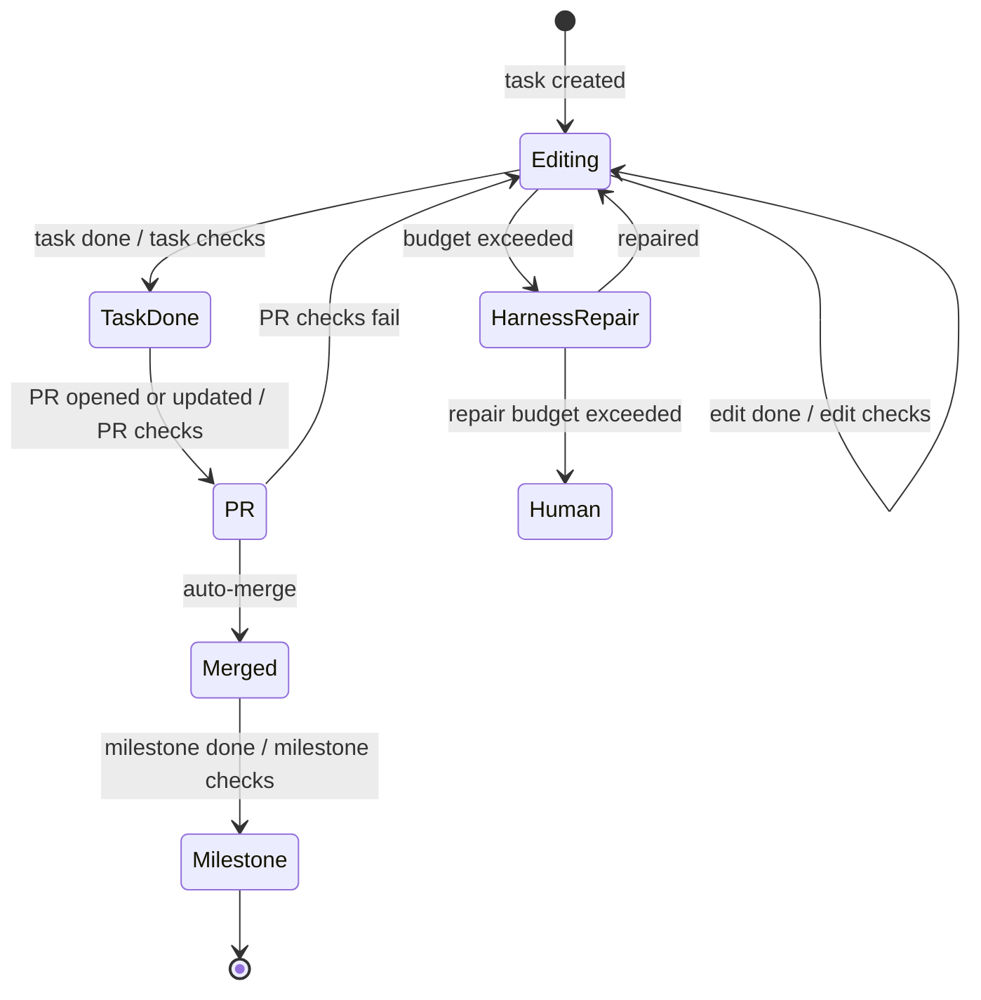

# shampoo: A Software Factory — Design Doc

> Lather, rinse, repeat.

- Status: Draft
- Created: 2026-11-17
- Name: `shampoo`

shampoo is a software factory: it keeps agents building a project with humans out of the loop (HOOTL). It is not tied to a particular project; a project plugs in its own checks and task sources. jeer is its first project.

| Part | Question |
|---|---|
| I. Why | Why build this? |
| II. What | What does the factory do, and what must it satisfy? |
| III. Usage | How does a project use it? |
| IV. Solution Design | How is it built? |

---

# Part I. Why

## 1. Motivation
When implementation becomes cheap, verification becomes most of the work (one practitioner reports about 70% of daily tokens going to verification [1]). Agents can write code fast; what limits them is whether their output can be trusted, and that depends on deterministic checks running at the right moments.

Today a human sits in that loop: assigning tasks, judging whether work is done, merging, and repairing the harness when it breaks. shampoo takes the human out of the loop. Humans set direction and review asynchronously; the loop keeps running without waiting for them.

---

# Part II. What

## 2. The SDLC as a state machine
The whole development lifecycle is a state machine. Work moves between states through transitions, and checks are the guards on those transitions. A check runs when, and only when, the transition it guards is attempted. There are no calendar-based runs.



Triggers do not add a schedule: an observed trigger creates a task, which enters the machine at Editing like any other.

## 3. Budgets
Transitions are governed by budgets, in the manner of SRE error budgets. When to retry, escape, stop product work, or fix a check is decided by which budget is exceeded, not by ad hoc rules.

| Budget | Charged by | When exceeded |
|---|---|---|
| Retry | Each failed attempt at a transition | Escape to harness repair |
| Workflow failure | Failures caused by the harness rather than the work: tool crashes, oracle nondeterminism, flaky tests | Stop product work; repair the harness |
| Time | A check's run time, against its test size's time limit [2] | Reorganize the check |
| False positive | Exceptions to a check | Fix the check |
| Human review | Exceptions and workflow changes awaiting asynchronous human review | Stop until reviewed |
| Repair | Each entry into harness repair within a task | Hand the task to a human |

Charging the right budget requires telling a task failure (the check found a problem in the work) from a workflow failure (the harness misbehaved). Every check reports which one it is.

The share of pure code, the small-test coverage of the whole code base, is reported on every PR. Adding side effects lowers it, by an amount that depends on the code base's size: the same addition moves a small code base's share much more than a large one's. A drop of more than one standard deviation, √(p(1−p)/N) with p the base's share smoothed as (covered + 1) / (total + 2) and N the head's statements, charges the budget of the rule that judges it.

Initial values are guesses and are adjusted from observation.

### 3.1 Units, windows and urgency
Budgets work as SRE error budgets do: urgency comes from how fast a budget is consumed, not from each failure on its own.
- **A rule's budget is part of the rule.** Its unit is a violation of the rule, and its window is counted in runs of the rule's check, not in time: there are no calendar-based runs. A check run on every edit, such as small tests, moves through its window fast, so a failure that persists over a few runs burns quickly. The rule gives its limit as counts, how many violations it allows in how many latest runs, such as 2 in 20: the share is the limit and the runs are the window
- **A limit of zero violations tolerates nothing**: any charge acts at once, whatever the rate, for what stops everything when it fails, such as a deploy
- **Actions follow the burn rate**, the share of the limit consumed over the share of the window elapsed, so that budgets of different rules compare on one scale. A fast burn escapes or stops work; a slow burn, through the window, leads to review or a task. A rule writes both in counts: its budget (2 in 20 runs by default), whose use in full is the slow burn and is reported, and its stop (2 in the latest 5 runs by default), the fast burn that sends the work to harness repair. shampoo computes burn rates from the counts to compare rules
- **The budgets shampoo charges itself** (retry, workflow failure, time, human review, repair) belong to no rule, and are counted the same way over the transitions they govern. A project sets their limits in `.shampoo/settings.toml`, by the states of the state machine (§2) they belong to: `max-failed-attempts` of a state is how many failed attempts it allows before the state machine moves on, such as `[state-machine.harness-repair]` before a human

Budgets come in four kinds. Each is attached where it is counted, by default where it always applies, with a default limit that a project overrides:

| Kind | Counts | Attached to | By default | Default limit |
|---|---|---|---|---|
| Rate | Violations in the latest runs of the check | Rule | Every rule | 2 in 20 runs |
| Stock | Open items at a time, such as exceptions to a check | Rule | Rules that allow exceptions, when they declare it | 3 |
| Count | Charges within a unit, such as failed attempts in one transition | Transition (retry), task (repair), milestone (workflow failure) | Always, by shampoo | 3 |
| Time | One run's duration, against the limit of its test size [2] | Check | Every check | Its size's limit |

Budgets are kept apart from rules only when one turns out to be shared.

### 3.2 Drift
What no rule catches can still pile up: each run within every limit, the process slowly worsening. The ledger records process metrics per task and PR: rework (failed guard attempts until merge), each check's run time, open exceptions, the share of pure code, escapes and workflow failures.
- **Each metric is watched against its own history**, on control charts (EWMA, CUSUM) that catch a small shift that persists, which a threshold per run misses
- **The whole is watched too**: an outcome metric, rework until merge, and the metrics' joint shift (a multivariate chart such as Hotelling's T²). Metrics can each stay within bounds while worsening together, and improving one can worsen the whole
- **A drift creates a task** to review its cause; the metric that shifted points to where to look

## 4. Requirements for HOOTL
The loop must keep running with no human present. That requires:

| Requirement | Why |
|---|---|
| Task supply | The next piece of work must appear without a human assigning it |
| Agent launch | Each task gets its own worktree and a headless agent session |
| Auto-merge | Work that passes the PR checks merges without waiting for a human |
| Failure classification and the workflow-failure budget | A broken harness must not be retried forever as if it were a task failure |
| Self-healing | Escapes become harness-repair tasks for an agent. A human is reached only when the repair budget is exhausted |
| Asynchronous human review | Human approval never blocks the loop directly; only the human-review budget does |

## 5. Principles for checks
- **A check failure always sends the work back.** No warnings
- **False positives pass only through an explicit exception with a written reason**, counted against that check's budget
- **Exceeding the budget means fixing the check**, not adding exceptions
- **Checks follow test sizes [2].** A check's size decides the earliest transition it can guard: small from edit done, medium from task done, large from PR
- **Checks are added when a trigger is observed**, cheapest first, and reorganized on cost (run time, failure cost). A check is not removed for catching nothing: catching nothing does not show it is ineffective
- **Agents don't change the checks that judge their own work.** Such changes go through the human-review budget

### 5.1 Acceptance tests
Tests come in two kinds, and only one of them belongs to the implementation:

| Kind | Role | In the same task as the implementation |
|---|---|---|
| White-box (small) tests | The implementer's own design artifacts; they depend on internal structure | Yes |
| Feature specs and black-box (acceptance) tests | The spec, made executable: checks that judge the implementation | No |

- **An implementation task never changes acceptance tests.** This follows from the rule above: an implementation that may rewrite its acceptance tests can pass anything
- **A behavior change starts with a spec-change task.** It updates the feature specs and acceptance tests, and goes through the human-review budget. Implementation tasks follow it
- **A scenario's content is its name and steps.** Its tags are not content
- **A scenario carries `@sha:<hash>`** of its content, which identifies the scenario as defined. A scenario without `@sha`, or whose `@sha` does not match its content, is new or changed, and carries `@skip`, written by whoever changes the spec: it is not run, so a spec change can land before its implementation. The implementation removes `@skip`, changing tags only. `@sha` is recorded by CI, never by hand: when feature files change, CI writes it on every scenario whose `@sha` is missing or does not match, after the check below, and commits
- **A change to feature files is checked on its own, statically**: every scenario whose `@sha` is missing or does not match carries `@skip`. No test runs for it
- **A commit that changes scenario content changes no production code**
- **A scenario with a matching `@sha` and no `@skip` that fails is a regression**: a task failure, sent back
- **Acceptance coverage shows what skipped scenarios leave untested.** Acceptance tests run against a binary built with `-cover`
- **When a spec change missed something** (e.g. a format change also breaks another command's tests), the implementation cannot satisfy both, exhausts its retry budget, and escapes. The repair is another spec-change task. An implementation agent that finds the spec wrong does not edit it; it escapes and proposes the spec change

### 5.2 Rules and policies
| Term | Definition |
|---|---|
| Rule | A categorical constraint on the work: it must hold. Its violation fails the transition and sends the work back |
| Check | The implementation of rules: a deterministic executable run at a transition, leaving results for judges (§7) |
| Judge | A rule's decision on its check's results: pass, task failure, workflow failure or a charge to the rule's budget (§3, §7) |
| Policy | Guidance that the harness puts into the agent's context. No check detects its violations; it takes effect only as far as the agent follows it |

- **The harness puts policies into the context at fixed times**: all policies when the orchestrator starts a task, and all of them again after the context is compacted. The agent does not choose whether to load them
- **A policy may carry a code example**: written inline, a reference `path#L<start>-L<end>` at a fixed commit, or none
- **Every rule passes on every code example.** A rule that fails on one contradicts the policy, and the rule is fixed
- **Policies and rules are defined independently**, in the project's configuration (§7). shampoo provides no defaults: their content is the project's own

## 6. Non-goals
- Project-specific checks: these come from the project (§7)
- Replacing CI or the code host: shampoo drives GitHub and GitHub Actions rather than reimplementing them

---

# Part III. Usage

## 7. What a project provides
A project provides these in `.shampoo/`, one file per item, named by its id:
- **Rules** (`.shampoo/rules/`), each with the transitions it guards, the paths whose changes start it, the id of its check, its judge and its budget (§3.1); a rule without a check states why, as `unchecked`
- **Checks** (`.shampoo/checks/`), each with its command, its test size and the checks it needs
- **Settings** (`.shampoo/settings.toml`), optional: shampoo's own settings by bounded context, such as the limits of the state machine (§3.1)
- **Policies** (`.shampoo/policies/`), each with its code example (§5.2)
- **Task sources**: where tasks come from (for jeer: clusters of mismatches against the oracle)

A check runs; a judge decides. A check only leaves results (its exit code, its output, the files it writes). A judge maps them to pass, task failure, workflow failure or a charge to its rule's budget: either the check's exit code through a mapping, or a command run on the check's results, through a mapping of that command's exit code.

A guard:
1. Selects the rules that guard the transition and whose paths cover what changed
2. Runs their checks once each, in the order of `needs`. Rules pointing to the same check share its run
3. After each check, judges every selected rule pointing to it
4. Stops when a judgment exceeds its rule's budget: the remaining checks are not run

`needs` only orders checks; it stops nothing.

The state machine (§2) is shampoo's own. Its transitions are bound to Claude Code hooks, CI and GitHub, so a project names them (`edit`, `task`, `pr`, `milestone`) and does not define them.

## 8. Commands
- `shampoo run`: the orchestrator. A long-running server that watches state and drives transitions between sessions (§11)
- `shampoo guard <transition>`: runs the guard for a transition. Called by hooks and CI

---

# Part IV. Solution Design

Implementation language: Go. The core is concurrent coordination (the reconciliation loop, agent sessions, CI results), and a Go binary starts fast enough for hooks to call `shampoo guard` directly.

## 9. Components

```
          task sources (project)
                 │
                 ▼
 ┌──────────────────────────────┐
 │ orchestrator (shampoo run)   │── worktree + headless agent session per task
 └──────────────────────────────┘
                 │ hooks / CI
                 ▼
 ┌──────────────────────────────┐      ┌────────────┐
 │ guard (shampoo guard)        │─────▶│ ledger     │
 │ checks → classify → decide   │      │ (JSONL)    │
 └──────────────────────────────┘      └────────────┘
                 │                            │
                 ▼                            ▼
   pass / send back / escape         budgets → self-healing tasks
```

## 10. Transitions

| Transition | Mechanism |
|---|---|
| Edit done | Claude Code PostToolUse hook on every tool [3]. It ignores which tool ran (agents also edit through Bash, Python, sed) and looks at files: what changed since the last passed guard, recorded as a git tree at each pass. If nothing changed, it does nothing |
| Task done | Claude Code Stop hook [3] in a headless session launched by the orchestrator. With no human to ask, every stop is an attempt at task done: the agent either thinks it is done or is stuck, and in both cases the guard decides |
| PR | CI on GitHub Actions, running `shampoo guard pr` |
| Merge | The orchestrator merges once the checks the change calls for have passed (below) |
| Milestone | A GitHub milestone, plus a manually dispatched workflow for large checks |
| Escape | The guard stops blocking and records the escape; the orchestrator creates a harness-repair task |

Which checks a PR needs depends on what it changes, since each workflow starts from the paths it checks. GitHub's required checks are a fixed list, and a required check whose workflow did not start waits forever; its auto-merge waits only on that list. So the merge is decided by the orchestrator:
- **Expected checks** are derived from the PR's changed paths, by the same rules as the workflows' path filters. The commit message check is always expected
- **The results that count** are those of runs started by the PR's latest commit that no run pushed. A run may change the code before checking it and push what it produced; those commits, on top of it, are the run's output and are covered by its results
- **A missing expected check means wait**, whatever the cause: a run not yet registered, one awaiting approval, or a commit that started none. Waiting past a time limit is a workflow failure
- **Automation delivers changes as PRs** opened with a token that starts workflows, never by pushing to another PR's branch, and no commit may skip CI

## 11. Who drives transitions
Transitions are driven by three actors.

| Actor | Transitions | How |
|---|---|---|
| Hooks (inside a session) | Edit done, task done | Synchronous calls to the guard. They must be synchronous, since the result decides whether the agent is sent back |
| Orchestrator (`shampoo run`) | Task done → PR, PR failed → Editing, PR passed → Merged, escape → harness repair | A reconciliation loop: it observes the actual state (git, GitHub, ledger) and acts to close the gap to the desired state |
| GitHub | PR checks | CI |

The orchestrator is level-triggered rather than event-driven. It does not react to events that could be lost; it looks at the state each time and decides the next action from it (e.g. a worktree with no running session and a passed task guard → open a PR; a PR with failing checks and no running session → launch a session to fix it). A restart only needs to look at the state again. Observing state periodically is not a scheduled check: checks still run only when a transition is attempted. Event notifications (e.g. webhooks) can be added later to wake the loop if its latency becomes a problem.

The flow of one task:
1. The orchestrator takes a task, creates a worktree, and launches a headless session
2. On every tool call, the PostToolUse hook calls `shampoo guard edit`; on failure the agent gets the reason and fixes it
3. When the agent tries to stop, the Stop hook calls `shampoo guard task`. On failure with retry budget left, the agent is sent back with the reason. On pass, or when the budget is exhausted, the stop is allowed and the outcome is recorded in the ledger
4. The orchestrator sees the ended session and the recorded outcome: on pass it pushes the branch and opens a PR with auto-merge; on escape it creates a harness-repair task
5. CI runs `shampoo guard pr`. On pass, the orchestrator merges. On failure, the orchestrator launches a new session in the same worktree with the failure reason

## 12. State and ledger
- **State** is derived from git and GitHub (a branch per task in its own worktree, the PR, whether it is merged). There is no separate state file to drift
- **Ledger**: JSON Lines in the git common directory, shared by all worktrees and not tracked. Each judgment at a transition is appended as one line: task (its branch), transition, rule, check, outcome, the check's duration. Rate, retry, workflow-failure and time budgets are counted from it. A line is written in one append, so worktrees writing at once do not interleave lines, and a broken last line is skipped
- **Statistics**: a separate JSON Lines file beside the ledger, one line per merged task: attempts per transition, violations per rule, run time per check. It is the evidence for tuning budgets and for drift (§3.2)
- **Compaction is automatic**: when a guard starts, the tasks whose branch is merged are summarized into statistics, and their lines leave the ledger, except the latest runs of each check within the window (§3.1). The ledger stays the size of the windows and the open tasks
- **JSON Lines rather than SQLite**: SQLite in Go needs cgo, which complicates cross-building and distributing one static binary, or a pure-Go port with many dependencies. The ledger only appends and reads the latest lines
- **Not in the ledger**: false-positive exceptions are counted from the code itself; the freeze flag is a labeled issue on GitHub, so CI can enforce it too; PR failures come from GitHub's check history

## 13. Bootstrapping
shampoo cannot be built by shampoo before it exists. It is built with a human in the loop up to the point where it can run HOOTL, and from then on its own changes go through shampoo.

The risk: whatever the guards miss at that point is carried into everything shampoo builds afterwards, including itself.

---

## 14. References
- [1] Lauren Tan, "All Code Is Slop (Except Mine)", AI Engineer CODE 2026. https://ai.engineer/code/2026/talks/lauren-tan
- [2] Google Testing Blog, "Test Sizes", 2010. https://testing.googleblog.com/2010/12/test-sizes.html
- [3] Claude Code hooks reference. https://code.claude.com/docs/en/hooks
